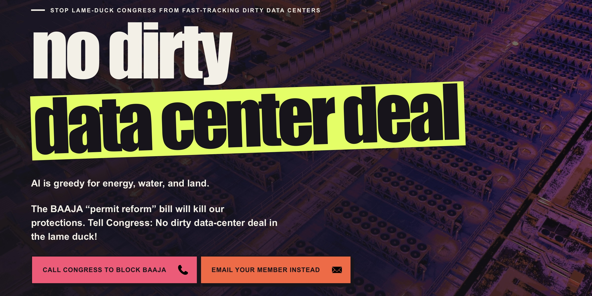
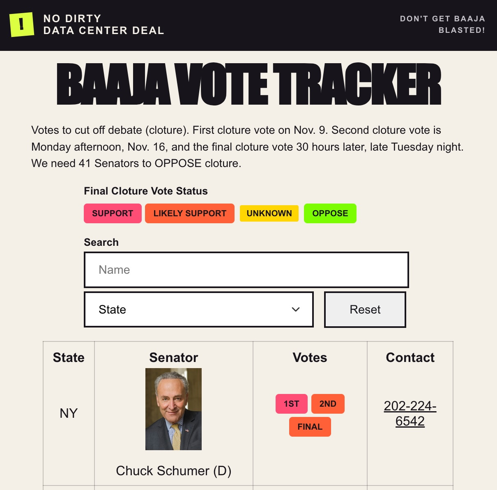

Looking to get back into the world of online advocacy, I contacted my old friend Brad Johnson at HillHeat.news to see about a collaboration. He alerted me to a bad bill that was being rushed through the lame duck Congress, and we partnered to build a rapid-response site to sound the alarm.

    

Integrating with CallPower, and updating some code that hadn't been touched in a long time, I got a site up and running on Cloudflare in a few days. Then iterating rapidly with Brad, we added an action calendar, vote tracker, and ActionNetwork embed to make the site a one-stop hub. The vote tracker in particular was praised for its [good design](https://bsky.app/profile/lookingforlight.bsky.social/post/3n2j5k3p6v22d), [compelling functionality](https://bsky.app/profile/chavabobava.bsky.social/post/3n2jksac3vc2z) and [ease of use](https://bsky.app/profile/bamwonky.bsky.social/post/3n2jkz6egac2f).

    

While the final vote count didn't go our way, I am proud of the work we did to raise a ruckus about this bad bill, and hopefully compel better action from Congressional Democrats in the coming session.
